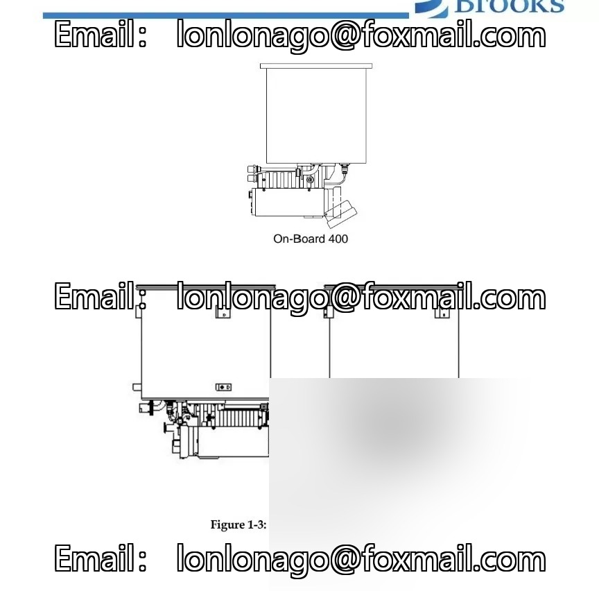
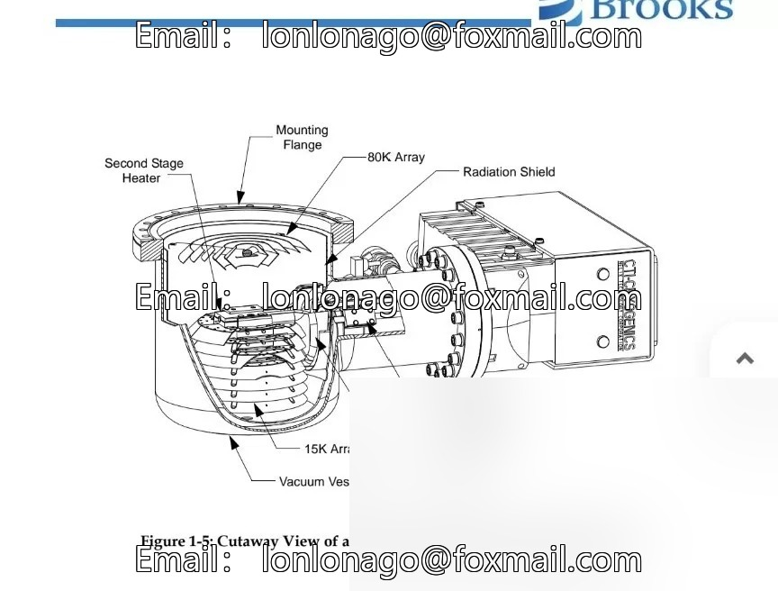
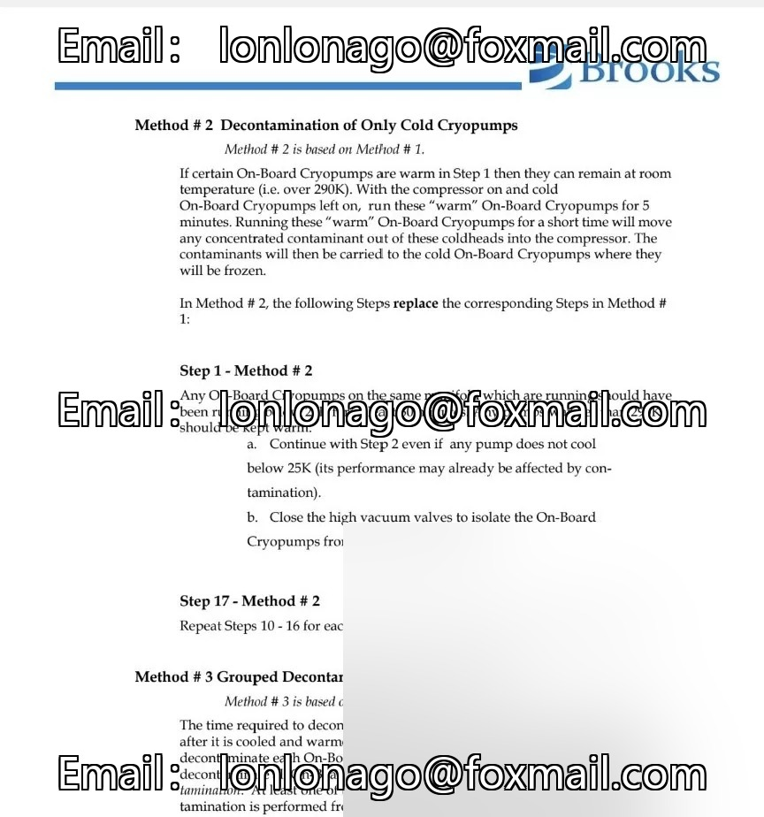

# Brooks Automation (Brooks Automation) official technology

## Body

Brooks Automation (Brooks Automation) official technical documentation, core product line of vacuum solutions (former CTI-Cryogenics department), covering models such as On-Board 8, 8F, Enhanced 8F, etc.

Content includes installation, maintenance, system principles, and freezing pump methods, suitable for high cleanliness UHV applications such as semiconductor ion injection and PVD processes.
8946
copyable, on sale.

Brooks Automation's official technical documentation covers core vacuum solution products including On-Board 8, 8F and Enhanced 8F models, with details on cryopump installation, maintenance, system principles and freezing methods suitable for high-cleanliness UHV applications such as semiconductor ion injection and PVD.

<!-- AI_ENRICHED -->

## Images

## Payment

Here is a pay link on Stripe ( https://buy.stripe.com/3cs8yP7sY87d0vu9AB ). Please contact me lonlonago@foxmail.com after funding $89, and I will send you a complete data files , thank you!

